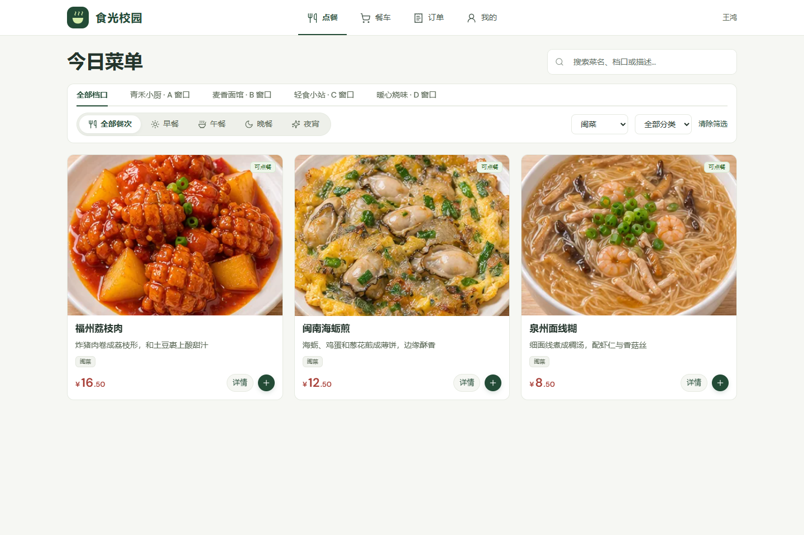

# 食光校园 · 食堂线上点餐系统

WEB 前端框架技术期末大作业 · G5 · 2026-11-23

学生在四个校园档口选餐，可将不同档口的菜品放入同一辆餐车，再分别下单。商家收到订单后通知取餐，学生凭码取餐并为实际吃过的菜品打星。桌面和手机共用账号、餐车和订单。

**当前进度**　F1–F5、E6、E7、O8 已通过本地验收，桌面与移动端均可演示。生产构建、预览、同源 Node 服务已实测；公网地址、实体手机访问与课堂答辩待完成。[逐项评分对照与实测数据](./docs/final-review.md) · [实验报告预览（PDF）](./docs/G5-食堂线上点餐系统实验报告.pdf) · [课程实验报告（Word）](./docs/G5-食堂线上点餐系统实验报告.docx)



菜单现有 **60 道菜、8 类餐品**，覆盖粤、闽、川、湘、苏、浙、鲁、徽菜及沪菜、西北风味。桌面和手机均可按菜系、档口、餐次和分类组合筛选。比如选择「闽菜」可找到福州荔枝肉、闽南海蛎煎和泉州面线糊。

## 在 VS Code 中运行

Windows 可双击仓库根目录的 [启动食光校园.cmd](./启动食光校园.cmd)。也可在 VS Code 打开仓库根目录，将终端选为 **命令提示符（CMD）**，执行以下命令。要求 Node.js `^20.19.0 || >=22.12.0`，本次验证使用 Node.js `22.23.2`、npm `10.9.8`。

```cmd
cd web
npm ci
set "DB_FILE=.local\final-demo\db.runtime.json"
npm run dev
```

打开 [本地登录页](http://127.0.0.1:5173/#/login)。开发入口同时启动前端 5173 与接口 3001。首次运行会从 `web/db.json` 复制演示库，内含 4 个档口、60 道菜与 2 笔示例订单。已有演示库在服务重启时自动追加这批菜品，并保留已有订单、菜品改价与上下架状态。切换到新的 `DB_FILE` 文件路径即可获得独立演示数据。服务重启后需要重新登录。

| 角色 | 演示账号 | 演示密码 | 入口 |
| --- | --- | --- | --- |
| 学生 | `32605150621` | `Shiguang@2026` | 选「学生账号体验」，直接打开今日菜单 |
| 档口商家 | `merchant01` | `Shiguang@2026` | 选「商家账号体验」，查看青禾小厨的菜品、订单与经营概览 |

学生主导航是「点餐、餐车、订单、我的」。商家登录后进入「订单工作台」，还可打开「菜品管理、经营概览、账号」。桌面把主导航放在顶部，手机放在底部。

## 体验一笔订单

1. 学生登录后搜索「红烧肉」，把青禾小厨的招牌红烧肉饭加入餐车，再从其他档口加一道菜。刷新后餐车仍保留两组。
2. 打开「餐车」，勾选青禾小厨并提交。页面显示订单号、取餐窗口和取餐码。回到餐车可继续结算另一档口。
3. 在独立浏览器会话中用商家账户登录，打开订单工作台，对刚才的单点击「通知取餐」。
4. 切回学生，从「订单」打开这笔订单，点击「我已取餐」并为菜品打星。再到菜品详情查看评价数和均分。
5. 手机沿同样的「点餐 → 餐车 → 订单」操作。答辩时也可在桌面直接打开 `/#/mobile` 体验手机壳演示。商家从「菜品管理」新增、改价、上下架和删除菜品。

[分档口结算](./screenshots/G5-20-按档口结算.png) · [经营概览](./screenshots/G5-21-档口经营.png) · [已取餐评价](./screenshots/G5-22-取餐后评价.png) · [手机菜单](./screenshots/G5-24-手机菜单.png) · [手机结算](./screenshots/G5-23-手机分档口结算.png)

## 功能与技术

| 题目项 | 实现与页面 |
| --- | --- |
| F1 登录与守卫 | 学生/商家登录，恢复会话，拦截越权访问；`/center` 嵌套概览、资料、偏好、安全四页。 |
| F2 菜单、E7 搜索 | `/menu` 按档口、菜系、分类、餐次和关键词筛选，展示库存状态；`/dish/:id` 展示菜品、成交评价及同档口推荐。 |
| F3 餐车、F4 下单 | 按账号持久化，双端共用增减和清空动作。按档口选单并以整数分计价，服务端重算，网络重试复用订单。 |
| F5 订单与状态 | `/orders` 和 `/order/:id` 可查看最新订单。商家推进本档口订单，学生可确认本人的待取餐订单。 |
| E6 档口管理 | 「菜品管理」`/admin/dishes` 支持表格与弹窗 CRUD、上架/下架；`/admin/overview` 显示本档口经营数据。 |
| O8 评价打星 | 仅已完成订单的购买者可按菜品评 1–5 星；修改同一评价后，详情重新计算均分。 |

前端采用 Vue 3 选项式 API、Vue Router hash 路由、Pinia、Element Plus、Vant 与 GSAP。Axios 访问 json-server，运行库由 Node 单进程维护。页面懒加载，菜单图与字体随仓库提供。模块边界、状态设计与接口见 [架构与评分对照](./docs/final-review.md) 和 [接口契约](./docs/api-contract.md)。

## 复验与部署

在 `web/` 中执行以下命令。浏览器测试在 Windows 使用已安装的 Chrome。其他操作系统可先运行 `npx playwright install chromium`。

| 命令 | 检查与本次结果 |
| --- | --- |
| `npm test` | 56/56 单元与接口用例通过，覆盖权限、金额、状态、评价、订单重试及旧演示库升级。 |
| `npm run test:e2e` | 16/16 浏览器用例通过，含桌面流程与 375 px 手机模拟。 |
| `npm run build`，再 `npm run test:preview` | 构建、静态资源、hash 深链接、离线恢复通过；6 个页面的 axe 自动扫描均为零违规。 |
| `npm run test:production` | 通过同源生产入口验证双角色、菜系筛选、新菜下单与取餐评价，并解码 60 张独立菜单图片。 |
| `npm run format:check` | 通过。 |

测试使用独立数据库。浏览器截图默认写入 `web/.local/screenshots/`；在 CMD 先执行 `set "SCREENSHOT_DIR=../screenshots"` 可重新归档展示图。已有构建时运行 `npm start`，即可访问 [同源生产服务](http://127.0.0.1:8080/#/login)，API 与页面共用端口。仓库提供 [Netlify 静态托管配置](./netlify.toml)，可连接独立 HTTPS API，也可采用 Nginx 反向代理。[部署配置、持久卷与验收步骤](./docs/deploy-32605150622.md)

## 五位成员与 GitHub 共建

王鸿是组长和仓库创建者。其余四位成员使用本人账号提交代码，分工及主分支中的历史交付如下。

| 学号 | 姓名 | GitHub 账号 | 负责范围 | 主分支交付证据 |
| --- | --- | --- | --- | --- |
| 32605150621 | 王鸿 | [WangHong3501](https://github.com/WangHong3501) | 页面 A、登录态、路由守卫、个人中心与集成 | [PR #1](https://github.com/WangHong3501/web-framework-final-canteen/pull/1) · [个人记录](./docs/contributions/32605150621-王鸿.md) |
| 32605150622 | 李岷鳌 | [21231gb](https://github.com/21231gb) | 点餐车金额与持久化、订单模块维护、构建优化和部署 | [提交 d0028d7](https://github.com/WangHong3501/web-framework-final-canteen/commit/d0028d704921738aa2874e2eb6eca85b17423c2b) 经 Git 合并进入 `main` · [个人记录](./docs/contributions/32605150622-李岷鳌.md) |
| 32605150604 | 翟毅 | [lulululululu28](https://github.com/lulululululu28) | 页面 B、菜单筛选、动态详情、档口菜品 CRUD | [PR #3](https://github.com/WangHong3501/web-framework-final-canteen/pull/3) · [个人记录](./docs/contributions/32605150604-翟毅.md) |
| 32605150601 | 陈续文 | [xuwen-max](https://github.com/xuwen-max) | 种子数据、json-server 业务接口、Axios 公共层和契约 | [PR #2](https://github.com/WangHong3501/web-framework-final-canteen/pull/2) · [个人记录](./docs/contributions/32605150601-陈续文.md) |
| 32605150615 | 江贤松 | [u12306q](https://github.com/u12306q) | Vant 手机点餐、公共 UI 与双端风格统一 | [提交 9060fa1](https://github.com/WangHong3501/web-framework-final-canteen/commit/9060fa1c544bf218ccf73e16bb21344b22ca1c5a) 直接进入 `main` · [双端记录](./docs/dual-ui-unification.md) |

协作时从 `main` 创建个人分支，使用本人账号小步提交，发起 PR 后由组长整合。各模块维护边界见 [五人分工](./docs/team-ownership.md)。[公开仓库](https://github.com/WangHong3501/web-framework-final-canteen) · [合并记录](https://github.com/WangHong3501/web-framework-final-canteen/pulls?q=is%3Apr+is%3Amerged)

## 工程与课程依据

| 位置 | 内容 |
| --- | --- |
| `web/src/` | 页面、共享组件、路由、业务仓库、网络层与公共样式 |
| `web/server/`、`web/db.json` | 开发及生产入口、会话与数据校验、演示种子 |
| `web/tests/` | 单元、接口、浏览器、静态预览和同源生产验收 |
| `deploy/`、`docs/`、`screenshots/` | 代理配置、实验报告与分工、界面实测截图 |

[课程题目册](./期末大作业-小组项目题目册（六组六题）.md) · [答辩评分表](./期末大作业-答辩评分表.docx) · [原始报告模板](./期末大作业-WEB前端框架技术-实验报告模板.docx) · [素材来源](./docs/assets-sources.md) · [页面 A 设计](./docs/page-a-design.md) · [页面 B 设计](./docs/page-b-design.md)
